# Hi, I'm Adrià 👋

Computer engineer and sysadmin based in Spain. By day I keep a fleet of Linux servers, networks and self-hosted services running; by night I work on game preservation and automate whatever I touch twice.

### 🎮 Game preservation

- [**AnyPS5**](https://github.com/boykopovar/AnyPS5): converting PS5 executables to run natively on Linux and Windows (300+ merged PRs)
- [**SavageWindRecomp**](https://github.com/Revivedx/SavageWindRecomp): static recompilation of *The Legend of Zelda: Breath of the Wild* to PC (in progress)

### 🛠️ Also

- 🤖 Big fan of working with AI: agents, automation and tooling that make day-to-day ops faster and less error-prone
- 🌐 Contributor to [**xdp-dns-evadeproxy**](https://github.com/Oihalitz/xdp-dns-evadeproxy): a Rust DNS proxy against ISP blocking
- 🧰 Tinkering with self-hosting, CI images and MCP servers

### Tech

           

### Stats

<picture>
  <source media="(prefers-color-scheme: dark)" srcset="./profile/stats-dark.svg">
  
</picture>
<picture>
  <source media="(prefers-color-scheme: dark)" srcset="./profile/top-langs-dark.svg">
  
</picture>
